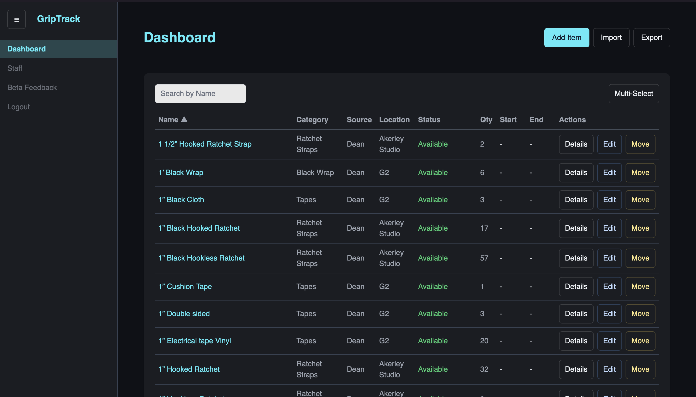
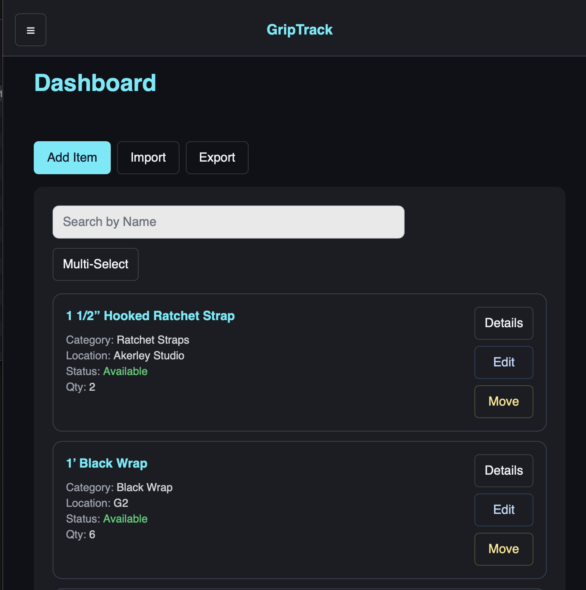
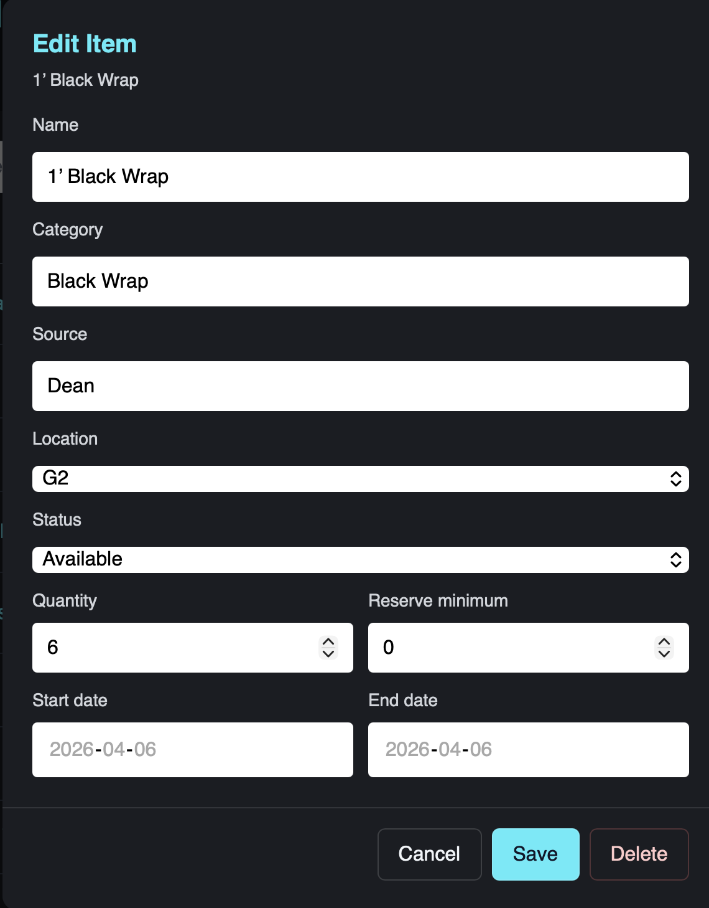

# GripTrack

GripTrack is equipment-inventory software for film crews: it tracks grip, lighting and rental gear across trucks, carts, stages and storage, in real time, and keeps working on set with no signal.

It focuses on fast workflows, partial-quantity moves, and the messy realities of rental paperwork.

| Desktop | Mobile | Edit |
|---|---|---|
|  |  |  |

## Repository layout

One repo, two apps, one Supabase backend.

| Path | What | Toolchain |
|---|---|---|
| `/` (root: `src/`, `public/`, `index.html`) | Web app — managers: billing, staff, teams, bulk edits, imports/exports | React 19, React Router 7, Vite, Tailwind CSS, Sentry; deployed by Vercel on every push to `main` |
| [`mobile/`](mobile/) | Crew app — day-to-day moves, requests, damage reports; offline-first | Expo (SDK version: `expo` in `mobile/package.json`), React Native, NativeWind 4, SQLite + a `sync_queue`; shipped through TestFlight and Google Play (see [`mobile/SHIPPING.md`](mobile/SHIPPING.md)) |
| [`supabase/`](supabase/) | Backend shared by both apps | Postgres migrations (`migrations/`), Deno edge functions (`functions/`), local stack config (`config.toml`) |
| [`shared/`](shared/) | Code used by both apps (`roles.ts` — role and permission rules) | Web imports it as `@shared/…`; mobile via a Metro watch folder |

Stack:

- **Frontend**: React + Vite (web), Expo / React Native (mobile)
- **Styling**: Tailwind CSS (custom design system)
- **Backend**: Supabase (Postgres, Auth, Edge Functions, RLS)
- **Email**: Resend (SMTP)

```text
src/
├─ main.jsx, App.jsx        # entry, Sentry init, routes
├─ pages/                   # Auth, InviteAccept, OrgSetup, CompleteProfile, Staff, TeamsPage,
│  │                        # LocationsPage, BillingPage, PricingPage, SettingsPage, ResetPassword, …
│  ├─ dashboard/            # inventory table: components/ (Edit, Move, Export, Details, AuditLog…),
│  │                        # hooks/ (useInventoryView, useEditFlow, useExport, …), utils/
│  ├─ requests/             # equipment requests (feature-flagged)
│  └─ legal/                # /privacy, /terms
├─ components/              # Sidebar, Modal, ImportFileModal (PDF/CSV import), PaywallGate,
│                           # TrialBanner, GhostBar, ErrorBoundary, feedback/, layout/
├─ context/                 # UserProvider (bootstrap_session), TeamProvider, EquipmentContext
├─ hooks/                   # useTrial, useTheme, useDebounce
└─ lib/                     # supabaseClient.js, stripe.js

mobile/src/
├─ screens/                 # auth, inventory, move, requests, profile, settings
├─ navigation/              # Root/App/Auth stacks and tabs
├─ context/                 # AuthContext, OrgContext, TeamContext, SyncContext
├─ hooks/                   # useInventory, useEquipmentMutations, useRequests, usePDFImport, …
└─ lib/                     # db.ts (SQLite + sync queue), supabase.ts, moveEquipment.ts, types.ts

supabase/
├─ migrations/              # the full schema, in order (prod == local)
├─ migrations_archive/      # pre-CLI hand-applied SQL — reference only, never apply
├─ functions/               # six edge functions (below)
│  └─ _shared/            # supabase-js pin, CORS/json helpers, requireUser, getAppUrl
└─ config.toml              # local stack + per-function settings
```

## Features

- **Inventory** — name, category, source (rental house), location, status (Available / Out / Damaged …), quantity, rental start/end dates.
- **Move and split** — move part of a quantity to another location; rows with identical item/location/state merge back together automatically.
- **Import** — rental PDFs and CSVs. Web parses PDFs in the browser (pdfjs-dist); mobile sends them to the `parse-rental-pdf` edge function.
- **Export** — CSV and print-friendly PDF of all, some, or the currently filtered locations; audit-log export.
- **Audit trail** — every insert/update/delete/move/merge/damage event is logged per item and per org.
- **Teams (optional, off by default)** and **equipment requests (optional)** — per-org feature flags in `organizations.features`.
- **Offline mobile** — the crew app reads and writes a local SQLite copy and replays queued changes when the network returns.
- **Billing and plans** — Stripe Checkout and Customer Portal. A new org starts on the Free plan (there is no trial on sign-up); Pro and Team are paid. Upgrading offers a 14-day Stripe trial (card required; only for orgs that have never had a subscription). Plan limits (see the Pricing page) are enforced server-side by the `enforce_plan_limits` database triggers and by `parse-rental-pdf`.
- **Feedback** — in-app bug/feature form for testers.

## Organizations and roles

Every user belongs to an organization (a production or company). Membership and role live in `organization_members` (not `profiles`). Roles are defined once in [`shared/roles.ts`](shared/roles.ts); RLS policies in `supabase/migrations/` enforce the same rules on the server — the UI checks are convenience, the database is the gate.

| Role | Can |
|---|---|
| `owner` | Everything, including billing and app settings. Never assignable by invite. |
| `admin` | Manage staff and invites, see and switch all teams, delete items. |
| `department_head` | Manage inventory (add/edit items, approve requests) within their team. |
| `crew` | View inventory, move gear, file requests and damage reports. |

Invites: an admin invites by email (`invite-staff` edge function → `org_invites` row + Supabase Auth email sent through Resend SMTP). The invitee signs in or signs up and the `accept_org_invite_for_user` RPC attaches them to the org. Web login loads org, role, subscription, team and profile in one `bootstrap_session()` RPC call.

Main tables: `organizations`, `organization_members`, `org_invites`, `profiles`, `teams`, `locations`, `equipment_items`, `equipment_audit`, `equipment_requests`, `subscriptions`, `beta_feedback`.

## Edge functions (`supabase/functions/`)

| Function | Called by | Purpose |
|---|---|---|
| `invite-staff` | web, mobile | Create/refresh an org invite and send the invite email |
| `delete-account` | web, mobile | For an owner, cancel the org's live Stripe subscription; then run `delete_my_account()` |
| `parse-rental-pdf` | mobile | Extract rental line items from a PDF (Hermes cannot run pdfjs) |
| `create-checkout-session` | web | Start Stripe Checkout for a plan |
| `create-portal-session` | web | Open the Stripe Customer Portal |
| `stripe-webhook` | Stripe | Sync subscription status into `subscriptions`; authenticated by the Stripe signature only, so it must be deployed with `verify_jwt = false` |

Shared helpers (supabase-js version pin, CORS/JSON responses, `requireUser`, `getAppUrl`) live in `supabase/functions/_shared/`; `APP_URL` is read by invite-staff, create-checkout-session and create-portal-session.

## Environment variables

**Web** — copy [`.env.example`](.env.example) to `.env.local` (gitignored). On Vercel these are project env vars.

| Variable | Required | Notes |
|---|---|---|
| `VITE_SUPABASE_URL` | yes | Project URL (or `http://127.0.0.1:54321` for the local stack) |
| `VITE_SUPABASE_ANON_KEY` | yes | Publishable anon key; RLS is the security boundary |
| `VITE_SENTRY_DSN` | no | Error tracking is a no-op without it |
| `SENTRY_AUTH_TOKEN`, `SENTRY_ORG`, `SENTRY_PROJECT` | Vercel only | Source-map upload during `vite build`; maps are deleted from `dist/` after upload |

**Mobile** — `mobile/.env.example` → `mobile/.env` for `expo start`: `EXPO_PUBLIC_SUPABASE_URL`, `EXPO_PUBLIC_SUPABASE_ANON_KEY`. EAS builds get the same two from EAS project env vars (preview + production).

**Edge-function secrets** (`supabase secrets set …`; `SUPABASE_URL`, `SUPABASE_ANON_KEY` and `SUPABASE_SERVICE_ROLE_KEY` are provided automatically): `STRIPE_SECRET_KEY`, `STRIPE_WEBHOOK_SECRET`, `STRIPE_PRO_PRICE_ID`, `STRIPE_TEAM_PRICE_ID`, `APP_URL`.

## Local development

Node: see [`.nvmrc`](.nvmrc) (CI uses it); `engines` in each `package.json` gives the floor.

```bash
# web
npm install
cp .env.example .env.local   # fill in values
npm run dev                  # http://localhost:5173
npx vitest run               # unit tests
npx eslint .                 # lint
npx vite build               # production build

# mobile (always from mobile/)
cd mobile
npm install
cp .env.example .env
npx expo start
npx jest --ci && npx tsc --noEmit
```

**Local Supabase stack** (Docker via colima: `colima start` first):

```bash
supabase start               # Studio http://127.0.0.1:54323, API :54321, DB :54322
supabase migration up        # apply new migrations to the running local DB
supabase functions serve     # run edge functions locally
```

`config.toml` sets the local auth `site_url` to `http://localhost:5173` so password-reset links land on the Vite dev server.

## Deploying

- **Web** — push to `main`; Vercel builds and deploys. CI (`.github/workflows/ci.yml`) runs web lint/test/build and mobile typecheck/test on every push.
- **Database** — new file via `supabase migration new <name>`, test locally, then `supabase db push`. Never edit a migration that has been pushed.
- **Edge functions** — deploy one at a time by name: `supabase functions deploy <name>`.
- **Mobile** — new EAS build + store submit; there are no over-the-air updates. See [`mobile/SHIPPING.md`](mobile/SHIPPING.md). Order when mobile code needs new SQL: `db push` → web push → EAS build.

## Project philosophy

- Real-world workflows over idealized data models
- Desktop for managers, mobile for the crew on set
- Clarity over cleverness
- Modals over browser-native confirms
- Data integrity over visual polish

GripTrack is designed to handle messy inputs, rapid workflows, and the human error typical of film production environments.

## Status

Private beta: web live at griptrack.app; iOS on TestFlight; Android on the Google Play internal testing track.
